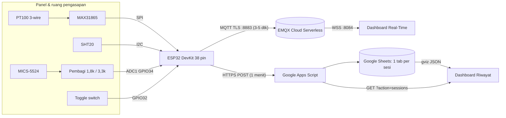
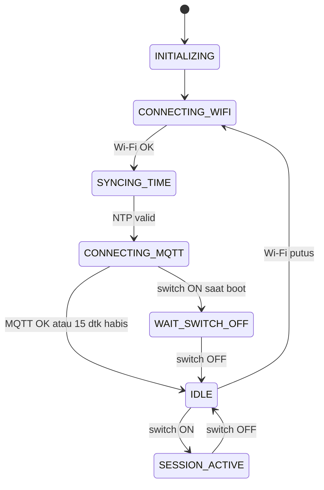

# Smoking Room Monitoring
### Sistem Monitoring Lingkungan Ruang Pengasapan Ikan Aktif

Sistem IoT untuk memantau **suhu**, **kelembapan relatif (RH)**, dan **gas CO** di ruang pengasapan ikan.
Data tampil **real-time** di dashboard web dan **tercatat per sesi** di Google Sheets (satu tab per sesi pengasapan).
Sesi dikendalikan dengan **satu toggle switch** di panel: ON = mulai, OFF = selesai.

> Mengacu pada dokumen kebutuhan **PRD-SMLRPI-001 v2.0**. Pengembangan dari proyek *Sport Hall Tilt Monitoring*
> (seluruh logika tilt/MPU sudah dibuang). Antarmuka mengikuti identitas Universitas Katolik Soegijapranata.

**Status:** kode lengkap. **Validasi pada perangkat keras dan uji lapangan belum dilakukan** (lihat [Status dan batasan](#14-status-dan-batasan)).

---

## Daftar isi
1. [Fitur](#1-fitur)
2. [Arsitektur](#2-arsitektur)
3. [Struktur repositori](#3-struktur-repositori)
4. [Perangkat keras](#4-perangkat-keras)
5. [Cara kerja](#5-cara-kerja)
6. [Skema data](#6-skema-data)
7. [Pemasangan](#7-pemasangan)
8. [Konfigurasi](#8-konfigurasi)
9. [Kalibrasi CO](#9-kalibrasi-co)
10. [Penggunaan sehari-hari](#10-penggunaan-sehari-hari)
11. [Keamanan](#11-keamanan)
12. [Pemecahan masalah](#12-pemecahan-masalah)
13. [Daftar uji (TC-001 – TC-023)](#13-daftar-uji-tc-001--tc-023)
14. [Status dan batasan](#14-status-dan-batasan)
15. [Lisensi dan kredit](#15-lisensi-dan-kredit)

---

## 1. Fitur
- **Satu toggle switch** untuk memulai/mengakhiri sesi. Tiap sesi membuat **tepat satu tab baru** di Google Sheets.
- **Dashboard Real-Time**: tiga kartu (Suhu, RH, CO) dengan **tiga grafik terpisah**, diperbarui lewat MQTT WebSocket tiap 3–5 detik.
  Menampilkan status sesi, durasi, kekuatan Wi-Fi, antrian data, dan koneksi broker.
- **Dashboard Riwayat**: pilih sesi dari daftar, lihat grafik, statistik (min/rata-rata/maks), dan tabel lengkap; tautan buka/unduh CSV.
- **Pencatatan per menit** ke Google Sheets lewat Google Apps Script, dengan penanda untuk data yang tertunda saat Wi-Fi putus.
- **Tahan gangguan**: reconnect Wi-Fi/MQTT tanpa memblokir, antrian RAM terbatas (120 baris ≈ 2 jam), anti-duplikat di server, watchdog 30 detik.
- **Tanpa alarm CO, tanpa ambang peringatan, tanpa notifikasi** (FR-019). CO ditampilkan sebagai nilai.
- **Tanpa data palsu**: sensor yang tidak terbaca ditampilkan "—" (grafik berhenti/celah, sel Sheets kosong), tidak pernah nol.
- **CO dalam mV sampai dikalibrasi**; nilai ppm baru muncul setelah kalibrasi diisi.
- **Konfigurasi tanpa kompilasi ulang** lewat Serial Monitor (Wi-Fi, broker, webhook, interval, kalibrasi).
- Data rahasia dipisah ke `secrets.h` yang tidak ikut ke GitHub.

## 2. Arsitektur



| Lapisan | Teknologi |
|---|---|
| Perangkat | ESP32 (Arduino C++), satu file `smokehouse.ino` |
| Real-time | MQTT (PubSubClient) ke EMQX Cloud Serverless, dashboard memakai MQTT.js + Chart.js |
| Pencatatan | Google Apps Script (Web App) + Google Sheets |
| Dashboard | HTML/CSS/JavaScript statis di GitHub Pages |
| Penyimpanan jangka panjang | Google Sheets saja (tanpa SD card, tanpa RTC) |

## 3. Struktur repositori

```
smoking-room-monitoring/
├── firmware/
│   └── smokehouse/
│       ├── smokehouse.ino        # seluruh firmware ESP32 (satu file)
│       ├── secrets.example.h     # contoh data rahasia  -> salin menjadi secrets.h
│       └── secrets.h             # (BUATAN ANDA, tidak ada di repo, diabaikan Git)
├── gsheet/
│   ├── Code.gs                   # Google Apps Script: webhook + daftar sesi
│   └── appsscript.json           # manifest (zona waktu Asia/Jakarta, Web App publik)
├── web/
│   ├── index.html  script.js     # dashboard Real-Time
│   ├── riwayat.html riwayat.js   # dashboard Riwayat
│   ├── common.js                 # fungsi bersama (format, jam, grafik)
│   ├── config.js                 # pengaturan dashboard (PUBLIK)
│   ├── style.css  unika.png
├── .github/workflows/
│   └── jekyll-gh-pages.yml       # workflow penerbitan folder web/ ke GitHub Pages
├── .gitignore                    # mengecualikan secrets.h
└── README.md
```

> Nama `jekyll-gh-pages.yml` adalah nama bawaan dari GitHub; isinya workflow penerbitan folder `web/`
> (checkout → configure-pages → upload-pages-artifact `path: web` → deploy-pages).

## 4. Perangkat keras

### 4.1 Komponen
| Fungsi | Komponen |
|---|---|
| Pengendali | ESP32 DevKit 38 pin |
| Suhu | Probe **PT100 3-wire** (SS304) + modul **MAX31865** |
| Kelembapan | **SHT20** (probe dengan mesh yang dapat dilepas), langsung I2C 3,3 V |
| Gas CO | **MICS-5524** (keluaran analog) + pembagi tegangan |
| Kendali sesi | **Toggle switch SPST** |
| Catu | HLK-10M05 (5 V), dioda 1N5819, fuse 1 A, kapasitor 220 µF, GND bersama |
| Lain-lain | Selang silikon dengan filter untuk jalur sampling gas, panel (enclosure) |

Kipas dan pompa air yang sudah ada **tidak dikendalikan** ESP32 (tidak ada output ke sana).

### 4.2 Pemetaan pin
| Fungsi | Pin ESP32 | Catatan |
|---|---|---|
| MAX31865 SCK / MISO / MOSI | 18 / 19 / 23 | SPI |
| MAX31865 CS | 5 | |
| SHT20 SDA / SCL | 21 / 22 | I2C 50 kHz (kabel panjang), tanpa ADS1115 |
| MICS-5524 AOUT | **34** (ADC1) | Lewat pembagi tegangan |
| Toggle switch | **32** ke GND | `INPUT_PULLUP`; ON = LOW |
| GPIO33 | tidak dipakai | Bekas tombol STOP |

### 4.3 Catatan perakitan
- **MAX31865**: jumper solder modul **harus diset 3-wire**. Nilai `PT100_RREF` di firmware 430 Ω; sesuaikan dengan resistor referensi di modul Anda.
- **Pembagi tegangan CO**: R1 = 1,8 kΩ (sisi AOUT), R2 = 3,3 kΩ (sisi GND), rasio = 3,3 / 5,1 ≈ **0,647**.
  Pada catu 5 V, tegangan AOUT maksimum ≈ 3,24 V di pin ESP32 — dekat batas jenuh ADC. Firmware menandai pin di atas 3100 mV sebagai di luar rentang.
- **Ukur dengan multimeter** tegangan GPIO34 (harus ≤ 3,3 V) **sebelum** menyambungkan MICS-5524 secara penuh.
- Letakkan titik ambil sampel gas **setelah kipas dan sebelum injeksi air**; arahkan exhaust ke area aman.
- Catu MICS-5524 5 V; sensor lain memakai 3,3 V.

## 5. Cara kerja

### 5.1 Kendali sesi (toggle switch)
| Kondisi | Perilaku |
|---|---|
| Switch OFF → ON | Mulai sesi: ID sesi, webhook START, tab baru, MQTT aktif, pencatatan per menit |
| Switch ON → OFF | Akhiri sesi: webhook STOP, waktu selesai dicatat, telemetry berhenti, kembali IDLE |
| Switch ON saat Wi-Fi/NTP belum siap | Menunggu; sesi mulai otomatis begitu siap selama switch masih ON |
| Switch **sudah ON saat ESP32 baru menyala** | **Tidak** langsung mulai. Status `WAIT_SWITCH_OFF` sampai switch digeser OFF lalu ON (mencegah sesi baru tak sengaja setelah listrik padam) |
| Debounce | Level dianggap sah setelah stabil 50 ms |

ID sesi berbentuk `YYYYMMDD-HHMMSS` (WIB), dan nama tab Sheets `YYYY-MM-DD HH.MM.SS` dari waktu **NTP**.
Sesi tidak bisa dimulai sebelum waktu NTP valid.

### 5.2 State machine

Wi-Fi atau MQTT putus **saat sesi aktif**: sesi **tetap berjalan**; data masuk antrian dan dikirim setelah tersambung kembali.
Bila broker MQTT lambat tersambung, perangkat tetap masuk IDLE setelah 15 detik agar pencatatan ke Sheets tidak bergantung pada broker.

### 5.3 Model eksekusi
| Task | Core | Tugas |
|---|---|---|
| `loop()` | 1 | Baca sensor (tiap 1 dtk), switch, state machine, sesi, perintah Serial |
| `mqttTask` | 0 | Wi-Fi, NTP, koneksi MQTT, publikasi telemetry dan status |
| `webhookTask` | 0 | Kirim antrian ke Apps Script |

Pengiriman jaringan yang lambat tidak menghambat pembacaan sensor maupun interval MQTT.

### 5.4 Pembacaan sensor
- **Suhu**: PT100 lewat MAX31865 (3-wire). Fault register dibaca tiap siklus; nilai di luar −50…400 °C dianggap fault.
- **RH**: SHT20 dibaca langsung via I2C (alamat 0x40) dengan pemeriksaan CRC. Bila tidak merespons, dicoba ulang tiap 5 detik.
- **CO**: 32 sampel ADC per siklus → buang 4 terendah dan 4 tertinggi → rata-rata → filter EMA (α = 0,2) → koreksi pembagi (÷ 0,647).
  Pemanasan sensor 2 menit sejak boot ditandai `flt` bit 8.
- Bit `flt`: `1` fault suhu · `2` fault RH · `4` sinyal CO di luar rentang · `8` CO masih pemanasan.

### 5.5 Keandalan data
| Mekanisme | Fungsi |
|---|---|
| Antrian RAM 120 slot | Menampung baris saat Wi-Fi putus. Penuh → baris DATA tertua dibuang; START/STOP dipertahankan |
| Tanda `offline` | Baris yang dibuat saat Wi-Fi putus ditandai di kolom Status; `ts` tetap waktu ukur asli |
| Anti-duplikat server | START ditolak bila `sid` sudah ada; DATA bila `seq` ≤ baris terakhir; STOP bila sudah selesai |
| Pengiriman berurutan + backoff | Jeda coba ulang 6–48 detik; penolakan permanen (mis. token salah) dibuang agar antrian tidak macet |
| Redirect Apps Script | POST → baca header `Location` → GET hasil; bila hasil 3× tak terbaca dianggap terkirim |
| Watchdog | Reset otomatis bila program macet 30 detik; penyebab reset dilaporkan di status |

## 6. Skema data

### 6.1 MQTT (EMQX)
| Topik | Arah | Retained | Kapan |
|---|---|---|---|
| `smokehouse/<device_id>/telemetry` | ESP32 → dashboard | tidak | Tiap `pub_ms` (default **4000 ms**), hanya saat sesi aktif |
| `smokehouse/<device_id>/status` | ESP32 → dashboard | **ya** | Saat state berubah, saat tersambung, dan tiap 30 detik |

Last Will pada `status`: `{"dev":"smk-01","state":"OFFLINE"}`.

**Telemetry**
```json
{"dev":"smk-01","sid":"20261110-143005","seq":42,"ts":1762759805,
 "temp_c":85.42,"rh":34.1,"co_mv":791,"co_pin_mv":512,"co_ppm":null,"co_cal":0,
 "flt":0,"t_flt":0,"rssi":-61,"qd":0}
```
| Field | Arti |
|---|---|
| `sid`, `seq`, `ts` | ID sesi, nomor pesan, epoch detik UTC (NTP) |
| `temp_c`, `rh` | °C dan %RH; `null` = sensor tidak terbaca |
| `co_mv` | Tegangan AOUT setelah koreksi pembagi (mV) — nilai utama CO bila belum dikalibrasi |
| `co_pin_mv` | Tegangan di pin GPIO34 (untuk verifikasi ≤ 3,3 V) |
| `co_ppm`, `co_cal` | ppm (`null` bila belum dikalibrasi), 1 = kalibrasi aktif |
| `flt`, `t_flt` | Bitmask kesehatan sensor; kode fault MAX31865 |
| `rssi`, `qd` | Kekuatan Wi-Fi (dBm); jumlah item webhook yang menunggu terkirim |

**Status**
```json
{"dev":"smk-01","state":"SESSION_ACTIVE","fw":"1.0.0","sid":"20261110-143005",
 "start_ts":1762759805,"ts":1762759925,"rssi":-61,"qd":0,"wh_rej":0,"rst":"POWERON"}
```
`state`: `INITIALIZING`, `CONNECTING_WIFI`, `SYNCING_TIME`, `CONNECTING_MQTT`, `WAIT_SWITCH_OFF`, `IDLE`, `SESSION_ACTIVE`, `OFFLINE`.

### 6.2 Webhook ESP32 → Apps Script (HTTP POST, JSON)
Semua permintaan memuat `token`.
```json
{"token":"…","action":"start","dev":"smk-01","sid":"20261110-143005","seq":0,"ts":1762759805,"sheet":"2026-11-10 14.30.05"}
{"token":"…","action":"data","dev":"smk-01","sid":"20261110-143005","seq":3,"ts":1762759985,
 "temp_c":85.42,"rh":34.1,"co_mv":791,"co_ppm":null,"flt":0,"offline":0}
{"token":"…","action":"stop","dev":"smk-01","sid":"20261110-143005","seq":18,"ts":1762760885}
```
| Respons | Arti | Sikap firmware |
|---|---|---|
| `{"ok":true,…}` | Berhasil | hapus dari antrian |
| `{"ok":true,"dup":true}` | Duplikat (kirim ulang) | hapus dari antrian |
| `{"ok":false,"error":"busy"/"internal","retry":true}` | Sementara | coba lagi |
| `{"ok":false,"error":"<kode>","retry":false}` | Ditolak permanen | buang, naikkan `wh_rej` |

Kode permanen: `unauthorized`, `server_not_configured`, `bad_json`, `empty_body`, `bad_action`, `bad_sid`, `bad_dev`, `bad_ts`, `bad_seq`, `unknown_session`.

### 6.3 API daftar sesi (HTTP GET, tanpa token)
`<WEB_APP_URL>?action=sessions[&limit=200][&callback=fn]`
```json
{"ok":true,"generated":1762760000000,"sessions":[
 {"sid":"20261110-143005","sheet":"2026-11-10 14.30.05","gid":123456789,"dev":"smk-01",
  "start_ts":1762759805,"finish_ts":1762760885,"status":"FINISHED"}]}
```
Urut dari terbaru. `status`: `FINISHED` atau `ACTIVE` (ACTIVE tanpa STOP = sesi belum ditutup, mis. listrik padam). `?action=ping` untuk uji koneksi.

### 6.4 Tata letak tab Google Sheets (satu tab per sesi)
| Kolom | Isi |
|---|---|
| A `Waktu` | Waktu pengukuran (WIB) |
| B `Suhu (°C)` | `temp_c` (kosong = fault) |
| C `RH (%RH)` | `rh` (kosong = fault) |
| D `CO (mV)` | `co_mv` |
| E `CO (ppm)` | `co_ppm` (**kosong bila belum dikalibrasi**) |
| F `Status Data` | `OK`, `OFFLINE (tersimpan lalu dikirim)`, `FAULT SUHU`, `FAULT RH`, `FAULT CO`, `CO PEMANASAN` |
| G `Seq` | Nomor baris dari ESP32 (dasar anti-duplikat) |
| I:J | Info sesi: Session ID, Perangkat, Mulai, Selesai |

Jangan mengganti nama tab sesi, jangan menghapus kolom G, dan jangan menggeser data di A–G.
Nilai disimpan sebagai **angka** (bukan teks), aman dari masalah koma/titik desimal locale Indonesia.

## 7. Pemasangan

Urutan: **EMQX → Google Sheets & Apps Script → Firmware → Dashboard web → Uji menyeluruh.**

### 7.1 EMQX Cloud Serverless
1. Buat deployment. Di halaman **Overview** catat alamat broker. Serverless **hanya TLS**: MQTT **8883**, WebSocket **8084** (path `/mqtt`). Port 1883 tidak tersedia dan koneksi anonim tidak didukung.
2. **Access Control → Authentication → + Add**, buat dua pengguna dengan password berbeda dan kuat:
   - `smk_device` — dipakai ESP32 (rahasia, boleh publish)
   - `smk_dashboard` — dipakai dashboard (**publik**, hanya baca)
3. **Access Control → Authorization**:
   - Tab *Username*: `smk_device` → Allow, Publish, `smokehouse/smk-01/#`; `smk_dashboard` → Allow, Subscribe, `smokehouse/#`.
   - Tab *All Users*: topik `#`, Publish and Subscribe, **Deny** (mode whitelist).
4. Uji dengan MQTTX (`mqtts://`, port 8883): pesan dari `smk_device` harus sampai ke `smk_dashboard`; publish dari akun dashboard tidak boleh diterima.

### 7.2 Google Sheets & Apps Script
1. Buat Spreadsheet baru → **Extensions → Apps Script**. (Bila editor gagal terbuka karena banyak akun Google aktif, pakai jendela Incognito dengan satu akun.)
2. Tempel `gsheet/Code.gs`. Di *Project Settings* centang **Show "appsscript.json" manifest file**, lalu ganti isinya dengan `gsheet/appsscript.json`.
3. *Project Settings → Script Properties → Add*: `TOKEN` = teks acak 32 karakter. (Opsional: `SPREADSHEET_ID` bila skrip tidak dibuat dari dalam Spreadsheet.)
4. Jalankan fungsi `setup()` sekali (beri otorisasi), lalu `selfTest()` — log harus menampilkan hasil `ok` dan `dup` yang sesuai.
5. **Deploy → New deployment → Web app**: *Execute as* **Me**, *Who has access* **Anyone**. Salin URL berakhiran `/exec`.
6. Uji di browser: `<URL>?action=ping` → `{"ok":true,…}`.
7. **Share → Anyone with the link: Viewer**; catat **ID Spreadsheet** (antara `/d/` dan `/edit`) — dibutuhkan dashboard Riwayat.
8. Mengubah kode kemudian: **Deploy → Manage deployments → ikon pensil → Version: New version → Deploy** (URL tetap).

### 7.3 Firmware ESP32
1. **Arduino IDE**, board **ESP32 Dev Module**, ESP32 Arduino core **2.0.14+ atau 3.x**.
2. Library (Library Manager): **Adafruit MAX31865 library** (beserta *Adafruit BusIO*) dan **PubSubClient** (Nick O'Leary).
3. Buka `firmware/smokehouse/smokehouse.ino` (nama folder harus sama dengan nama file `.ino`).
4. Salin `secrets.example.h` menjadi **`secrets.h`** di folder yang sama, lalu isi:
   ```cpp
   #define WIFI_SSID       "nama-wifi"
   #define WIFI_PASSWORD   "password-wifi"
   #define MQTT_HOST       "<alamat-broker-EMQX>"   // nama domain, bukan IP
   #define MQTT_PORT       8883
   #define MQTT_USE_TLS    1
   #define MQTT_USER       "smk_device"
   #define MQTT_PASS       "<password smk_device>"
   #define WEBHOOK_URL     "https://script.google.com/macros/s/<ID>/exec"
   #define WEBHOOK_TOKEN   "<sama dengan Script Property TOKEN>"
   #define DEVICE_ID       "smk-01"
   ```
   Jangan memakai tanda kutip ganda (`"`) atau backslash (`\`) di dalam nilai.
5. Unggah. Buka **Serial Monitor** (115200 baud, ujung baris **Newline**). Tunggu `>> STATE: IDLE`.

### 7.4 Dashboard web dan GitHub Pages
1. Edit **`web/config.js`** (file ini **PUBLIK**, ikut terbit di situs):
   ```js
   window.APP_CONFIG = {
     DEVICE_ID: "smk-01",                                  // sama dengan firmware
     MQTT:   { URL: "wss://<alamat-broker>:8084/mqtt",
               USERNAME: "smk_dashboard", PASSWORD: "<password dashboard>" },
     SHEETS: { SPREADSHEET_ID: "<ID Spreadsheet>",
               WEB_APP_URL: "https://script.google.com/macros/s/<ID>/exec" },
     STALE_AFTER_S: 15,      // tanpa data selama ini saat sesi aktif -> "tidak ada data baru"
     CHART_MAX_POINTS: 300   // titik grafik real-time (300 × 4 dtk = 20 menit)
   };
   ```
   Hanya isi akun **`smk_dashboard`**. **Jangan** pernah mengisi token webhook atau akun `smk_device` di sini.
2. Uji lokal: `python -m http.server` di folder `web/`, buka `http://localhost:8000`.
3. Terbitkan: **Settings → Pages → Build and deployment → Source: GitHub Actions**. Workflow di `.github/workflows` menerbitkan folder `web/`
   setiap ada push ke `main` yang mengubah `web/**` (atau jalankan manual lewat tab **Actions → Run workflow**).
4. Alamat situs: `https://<USERNAME>.github.io/smoking-room-monitoring/`.

> Akun GitHub *Free* hanya dapat memakai Pages untuk repositori **publik**; repositori privat memerlukan paket berbayar.

### 7.5 Uji menyeluruh
1. Buka dashboard Real-Time: status broker **Tersambung**, banner menampilkan status perangkat.
2. Geser switch ke **ON**. Serial: `SESI MULAI …`, `Webhook START … -> HTTP 302` lalu `… hasil -> HTTP 200`. Tab baru muncul di Sheets; grafik dashboard mulai bergerak.
3. Satu menit kemudian muncul baris data pertama (`Webhook DATA seq=1 …`), lalu tiap menit.
4. Geser ke **OFF**: `Webhook STOP …`, sel `J4` di tab berisi waktu selesai.
5. Buka halaman **Riwayat**: sesi tampil `FINISHED` lengkap dengan grafik dan tabel.

Tanpa sensor terpasang, nilai suhu/RH tampil "—" dan `flt` menyala (normal); alur sesi dan pencatatan tetap bisa diuji.

## 8. Konfigurasi

### 8.1 Prioritas
`secrets.h` memberi nilai **default**. Nilai yang diatur lewat **Serial Monitor** disimpan di memori flash (NVS) dan **menimpa** default tanpa kompilasi ulang.

### 8.2 Perintah Serial Monitor (115200 baud, Newline)
| Perintah | Fungsi |
|---|---|
| `help` | Tampilkan bantuan |
| `show` | Konfigurasi aktif (kata sandi disamarkan) |
| `status` | State, koneksi, antrian, pembacaan terakhir, `heap` |
| `set <kunci> <nilai>` | Ubah konfigurasi (disimpan permanen; nilai boleh berspasi) |
| `unset <kunci>` | Kembali ke default dari `secrets.h` |
| `reset` | Hapus semua penimpaan |
| `reboot` | Mulai ulang (perubahan berlaku setelah reboot) |

### 8.3 Kunci konfigurasi
| Kunci | Arti | Default |
|---|---|---|
| `wifi_ssid`, `wifi_pass` | Wi-Fi | dari `secrets.h` |
| `mqtt_host`, `mqtt_port`, `mqtt_tls` | Broker | dari `secrets.h` |
| `mqtt_user`, `mqtt_pass` | Akun publish | dari `secrets.h` |
| `webhook_url`, `webhook_token` | Apps Script | dari `secrets.h` |
| `device_id` | ID perangkat (bagian topik MQTT) | `smk-01` |
| `pub_ms` | Interval telemetry MQTT (ms) | `4000` (rentang PRD 3000–5000; minimum 500) |
| `log_ms` | Interval baris ke Sheets (ms) | `60000` (minimum 5000) |
| `co_mode` | Kalibrasi CO: `0` belum, `1` linear, `2` pangkat | `0` |
| `co_a`, `co_b`, `co_r0`, `co_rl` | Konstanta kalibrasi CO | `0, 0, 0, 10000` |
| `temp_off`, `rh_off` | Koreksi akurasi (°C / %RH) | `0` |

Contoh: `set pub_ms 3000` → `reboot`.

### 8.4 Konstanta di dalam `smokehouse.ino`
Bagian "1. KONFIGURASI & KONSTANTA": pin, `PT100_RREF`, pembagi tegangan, filter CO, `QUEUE_CAPACITY` (120), `WDT_TIMEOUT_S` (30), `CO_WARMUP_MS` (120000), zona waktu NTP (WIB), dan `PRINT_SAMPLES` (1 = cetak satu baris pembacaan per detik).

## 9. Kalibrasi CO

Selama `co_mode 0`, CO hanya dilaporkan dalam **mV** dan `co_ppm` bernilai `null`. Ini disengaja: konversi ke ppm bergantung pada kondisi sensor Anda
(nilai di udara bersih, suhu, kelembapan), dan angka ppm tanpa kalibrasi akan terlihat meyakinkan padahal salah — berbahaya untuk pemantauan gas beracun.

| Mode | Rumus | Konstanta |
|---|---|---|
| `1` linear | `ppm = co_a × mV + co_b` | `co_a`, `co_b` |
| `2` pangkat | `Rs = co_rl × (5000 / mV − 1)`; `ppm = co_a × (Rs / co_r0)^co_b` | `co_a`, `co_b`, `co_r0`, `co_rl` |

Cara mengisi, contoh mode linear:
```
set co_mode 1
set co_a 0.1
set co_b -25
reboot
```
(Angka di atas hanya contoh format, **bukan** kalibrasi sungguhan.) Nilai yang benar harus berasal dari titik acuan nyata:
pembacaan di udara bersih ditambah minimal satu pembacaan pada konsentrasi CO yang diketahui (alat pembanding atau gas kalibrasi).
Respons MICS-5524 tidak linear, sehingga kalibrasi linear dua titik hanya perkiraan kasar.

Setelah kalibrasi aktif, dashboard menampilkan **ppm** (dengan mV mentah sebagai keterangan) dan Sheets mengisi kolom `CO (ppm)`.

## 10. Penggunaan sehari-hari
1. Nyalakan panel. Tunggu dashboard menampilkan **"Tidak ada sesi aktif"** (perangkat IDLE).
2. Geser switch ke **ON** saat pengasapan dimulai.
3. Pantau dashboard Real-Time. Tidak perlu membuka Sheets.
4. Geser switch ke **OFF** saat selesai. Data lengkap ada di tab sesi di Sheets dan di halaman **Riwayat**.
5. Bila listrik padam saat sesi, sesi lama tersisa berstatus `ACTIVE` (belum ditutup) di Riwayat. Setelah listrik kembali, switch yang masih ON **tidak** memulai sesi baru:
   geser OFF lalu ON.

**Perawatan** (tiap 2–3 sesi pengasapan): lepas mesh SHT20, rendam IPA, keringkan, pasang kembali; ganti media kapas pada filter jalur sampling. Periksa sambungan selang tidak bocor dan air tidak mencapai selang.

## 11. Keamanan

### 11.1 Peta data rahasia
| Data | Disimpan di | Rahasia? |
|---|---|---|
| Wi-Fi, akun EMQX `smk_device`, URL Web App, `WEBHOOK_TOKEN` | `secrets.h` (lokal) atau NVS lewat Serial | **Ya** |
| `TOKEN` (sisi server) | Apps Script → Script Properties | **Ya** |
| Akun EMQX `smk_dashboard`, ID Spreadsheet, URL Web App | `web/config.js` | **Publik** (terbaca siapa pun) |

### 11.2 Aturan wajib
- **`secrets.h` tidak boleh masuk Git.** Pastikan `.gitignore` ada dan memuat `secrets.h`, dan periksa `git status` sebelum setiap commit.
- `web/config.js` hanya memuat akun **baca** (`smk_dashboard`); tidak ada token atau akun publish.
- Rahasia yang terlanjur ter-push dianggap **bocor**: ganti kredensialnya (EMQX, token, deployment), baru bersihkan riwayat Git. Menghapus file saja tidak cukup.

### 11.3 Kontrol yang diterapkan
- EMQX: otentikasi wajib + otorisasi whitelist (Allow per pengguna, Deny-all untuk semua).
- Webhook: token wajib (dibandingkan waktu-tetap), token salah ditolak permanen, validasi `sid`/`ts`/`seq`/`dev`, nilai tak valid menjadi sel kosong.
- Dashboard: semua data eksternal dimasukkan lewat `textContent`; versi library CDN dikunci; tidak ada API notifikasi.
- Spreadsheet: publik hanya dapat **melihat**; penulisan hanya lewat Apps Script yang berjalan sebagai pemilik.

### 11.4 Keterbatasan TLS (diketahui)
Koneksi ESP32 ke EMQX dan ke Google **terenkripsi TLS, tetapi sertifikat server belum diverifikasi** (`setInsecure`).
Penyerang aktif di jaringan Wi-Fi yang sama secara teori dapat menyamar sebagai server dan membaca token webhook atau kredensial publish.
Dampaknya dibatasi oleh: token hanya memberi hak menulis baris data sesi, akun publish hanya boleh publish ke topiknya sendiri, dan tidak ada kendali aktuator.
Mitigasi: gunakan jaringan Wi-Fi tepercaya; untuk EMQX, unduh sertifikat CA dari halaman Overview dan isi `MQTT_CA_CERT` di `secrets.h` (didukung firmware).

### 11.5 Daftar periksa sebelum dipakai di lapangan
- [ ] `secrets.h` hanya ada di komputer; `git status` tidak menampilkannya
- [ ] `config.js` hanya berisi akun `smk_dashboard`
- [ ] EMQX: aturan Allow per pengguna + Deny-all di "All Users"
- [ ] Script Property `TOKEN` terisi dan sama dengan firmware
- [ ] Web App: Execute as **Me**, access **Anyone**; Spreadsheet: **Viewer** untuk link
- [ ] `co_mode` sesuai (0 sampai kalibrasi nyata tersedia)
- [ ] Tab uji dan sesi uji dihapus dari Spreadsheet produksi

## 12. Pemecahan masalah
| Gejala | Penyebab / tindakan |
|---|---|
| Tab terbentuk tetapi tidak ada baris data | Lihat baris `Webhook … -> HTTP …` di Serial; pastikan firmware terbaru dan Web App **Anyone** |
| `MQTT: gagal (rc=5)` | Username/password atau Authorization EMQX salah |
| `MQTT: gagal (rc=-2)` | Jaringan/TLS gagal; pakai nama domain (bukan IP), port 8883, `MQTT_USE_TLS 1` |
| Serial: `dialihkan ke alamat asing` | Web App belum diatur **Execute as Me / Anyone** |
| `unauthorized` | `WEBHOOK_TOKEN` firmware ≠ Script Property `TOKEN` (cek spasi tersembunyi) |
| `bad_ts` | Waktu NTP belum valid |
| `unknown_session` | Pesan START belum pernah berhasil, atau tab sesi terhapus |
| Dashboard "Autentikasi broker gagal" | Akun di `config.js` salah atau Authorization EMQX kurang |
| Dashboard "Konfigurasi belum lengkap" | `web/config.js` masih berisi placeholder (`ISI_…`) |
| Riwayat kosong / galat | Spreadsheet belum "Anyone with the link: Viewer"; `WEB_APP_URL` salah |
| Serial: `E (...) i2c.master: I2C hardware NACK` | SHT20 tidak terpasang/kabel; dicoba ulang tiap 5 dtk |
| `T=-999 RH=-999` di Serial | Hanya penanda tampilan "tidak ada pembacaan"; yang dikirim adalah `null` |
| `heap` terus turun | Dua koneksi TLS aktif bersamaan; pantau dengan perintah `status` |
| Editor Apps Script tidak terbuka | Banyak akun Google aktif; pakai Incognito dengan satu akun |
| Perubahan kode Apps Script tidak berlaku | Belum *Deploy → Manage deployments → New version* |
| Situs Pages 404 | Tunggu 1–2 menit setelah deploy hijau; alamat harus memakai nama repo |
| Workflow Pages gagal: *Pages not enabled* | Settings → Pages → Source harus **GitHub Actions** |

## 13. Daftar uji (TC-001 – TC-023)
Daftar kasus uji dari PRD yang perlu dijalankan pada perangkat. Tandai saat selesai.

| TC | Uji | Selesai |
|---|---|---|
| TC-001 | Akurasi suhu PT100 vs termometer acuan (toleransi 5–10%) | ☐ |
| TC-002 | Akurasi RH SHT20 vs higrometer acuan | ☐ |
| TC-003 | Pembacaan CO, GPIO34 ≤ 3,3 V, filter ADC stabil | ☐ |
| TC-004 | Stempel waktu NTP sesuai waktu acuan | ☐ |
| TC-005 | START: sesi mulai, sheet baru terbentuk, data pertama tampil | ☐ |
| TC-006 | STOP: data berhenti, waktu selesai tercatat | ☐ |
| TC-007 | Debounce: satu pergeseran switch = satu aksi | ☐ |
| TC-008 | Interval MQTT 3–5 detik | ☐ |
| TC-009 | Satu baris per menit di Sheets (jumlah baris = durasi menit) | ☐ |
| TC-010 | Dua sesi berurutan = dua tab bernama tanggal-waktu | ☐ |
| TC-011 | Pemulihan koneksi Wi-Fi/broker tanpa restart; data tertunda terkirim | ☐ |
| TC-012 | Interval mengikuti konfigurasi (`pub_ms`, `log_ms`) | ☐ |
| TC-013 | Ganti Wi-Fi/broker/URL webhook lewat Serial tanpa kompilasi ulang | ☐ |
| TC-014 | Dashboard real-time di web dan ponsel, update 3–5 detik | ☐ |
| TC-015 | Endpoint daftar sesi = daftar tab sesi | ☐ |
| TC-016 | Riwayat: seluruh baris tampil, desimal benar | ☐ |
| TC-017 | Nilai CO tinggi tampil tanpa alarm/ambang/notifikasi | ☐ |
| TC-018 | Ketahanan komponen dalam ruang hingga 100 °C | ☐ |
| TC-019 | Suhu udara di sensor CO tidak melampaui batas lembar data | ☐ |
| TC-020 | Verifikasi kelistrikan (polaritas, fuse, dioda, GND, 5 V/3V3/GPIO34) | ☐ |
| TC-021 | Jalur sampling kedap, titik ambil benar, exhaust di area aman | ☐ |
| TC-022 | Prosedur perawatan (mesh SHT20, media filter) | ☐ |
| TC-023 | Satu sesi penuh tanpa reset tak terencana | ☐ |

Urutan yang disarankan: kelistrikan (TC-020) → tegangan GPIO34 (TC-003) → sensor satu per satu → akurasi → switch → jaringan → satu sesi penuh → uji lapangan.

## 14. Status dan batasan
**Sudah:**
- Firmware, Apps Script, dan dashboard lengkap sesuai PRD (dengan perubahan toggle switch).
- Jalur data diamati bekerja pada uji **simulasi** (ESP32 + broker + Sheets asli, tanpa sensor): START membuat tab baru dan baris data tercatat.

**Belum:**
- **Validasi pada perangkat keras dan uji lapangan** (TC-001–003, 007, 018–023 dan pengukuran interval/pemulihan koneksi).
- Verifikasi sertifikat TLS (lihat [11.4](#114-keterbatasan-tls-diketahui)).
- Kalibrasi CO nyata (OI-002); sampai saat itu CO hanya dalam mV.

**Batasan yang perlu diketahui:**
- Antrian RAM hanya ±2 jam; bila Wi-Fi putus lebih lama, baris DATA tertua dibuang (START/STOP dipertahankan). Tidak ada SD card/RTC.
- Satu Spreadsheet dibatasi sekitar 10 juta sel; tiap tab baru memakai grid bawaan sehingga cukup untuk ±380 sesi. Arsipkan atau hapus tab lama bila mendekati batas.
- Dua koneksi TLS aktif bersamaan (MQTT dan HTTPS) memakai banyak RAM pada ESP32 tanpa PSRAM; pantau `heap` pada sesi panjang (TC-023).
- EMQX Cloud Serverless memiliki kuota gratis terbatas (sesi-menit dan trafik); pantau di halaman Overview.
- Sesi yang tidak ditutup (listrik padam sebelum STOP) tetap berstatus `ACTIVE` di Riwayat.
- Perubahan dari PRD asli: dua tombol START/STOP diganti satu toggle switch (CR-001). Dokumen PRD perlu direvisi agar konsisten.
- Kalibrasi linear dua titik hanyalah perkiraan kasar untuk MICS-5524.

## 15. Lisensi dan kredit
- **Lisensi:** belum ditetapkan. Tambahkan berkas `LICENSE` sebelum repositori dibagikan atau dipakai pihak lain.
- Dikembangkan berdasarkan **PRD-SMLRPI-001 v2.0** (Sistem Monitoring Lingkungan Ruang Pengasapan Ikan Aktif).
- Berawal dari proyek *Sport Hall Tilt Monitoring*; antarmuka mempertahankan identitas visual Universitas Katolik Soegijapranata.
- Library: PubSubClient, Adafruit MAX31865, MQTT.js, Chart.js, Font Awesome.
