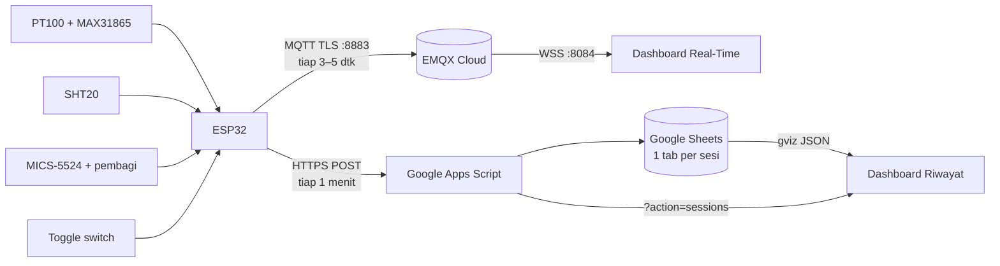

# Smoking Room Monitoring — Web Dashboard

Sistem monitoring real-time untuk ruang pengasapan ikan: suhu, kelembapan relatif (RH), dan gas CO ditampilkan di dashboard web dan dicatat per sesi ke Google Sheets.

---

## 1. Objek & Metrik yang Dipantau

| Metrik | Sumber | Satuan | Catatan |
|---|---|---|---|
| **Suhu ruang** | PT100 3-wire via MAX31865 | °C | Rentang valid −50…400 °C, fault bila di luar |
| **Kelembapan relatif (RH)** | SHT20 (I2C) | %RH | Pemeriksaan CRC; dicoba ulang tiap 5 dtk bila gagal |
| **Gas CO** | MICS-5524 (ADC, via pembagi tegangan) | mV (default), ppm (opsional) | ppm hanya muncul setelah kalibrasi diisi |
| **Status sesi** | Toggle switch (GPIO32) | — | ON = mulai, OFF = selesai |
| **Kesehatan sensor** | Bitmask `flt` | — | Bit 1 suhu, 2 RH, 4 CO out-of-range, 8 warmup |
| **Konektivitas** | RSSI Wi-Fi, status broker, antrian webhook | — | Untuk diagnosa di dashboard |

Tidak ada alarm, ambang peringatan, atau notifikasi otomatis. Nilai yang tidak terbaca ditampilkan **"—"** (tidak pernah nol).

---

## 2. Arsitektur Sistem & Alur Data



**Alur ringkas:**
1. ESP32 membaca ketiga sensor tiap 1 detik.
2. **Saat sesi aktif**, telemetry dikirim ke broker MQTT (TLS). Dashboard Real-Time berlangganan via WebSocket.
3. Satu baris data per menit dikirim ke Google Apps Script → ditulis ke tab baru di Google Sheets.
4. Dashboard Riwayat membaca daftar sesi dari Apps Script dan data barisnya via Google Visualization API (`gviz`).
5. Wi-Fi/broker putus: sesi tetap berjalan, data masuk antrian RAM (120 slot ≈ 2 jam) dan dikirim ulang otomatis.

---

## 3. Fitur Utama Dashboard

### Dashboard Real-Time (`index.html`)
- **Update 3–5 detik** via MQTT WebSocket.
- Tiga kartu metrik (Suhu, RH, CO) + **tiga grafik terpisah** (Chart.js, 300 titik ≈ 20 menit).
- Banner status perangkat: `IDLE`, `SESSION_ACTIVE`, `WAIT_SWITCH_OFF`, `OFFLINE`.
- Info sesi: ID, durasi berjalan, kekuatan Wi-Fi (dBm), antrian data, status koneksi broker.
- Menandai "tidak ada data baru" bila tidak ada pesan > `STALE_AFTER_S`.
- Responsif (desktop & ponsel).

### Dashboard Riwayat (`riwayat.html`)
- Daftar sesi (dari Apps Script) — pilih untuk melihat detail.
- Grafik histori per sesi + statistik **min / rata-rata / maks**.
- Tabel lengkap baris per menit.
- Tautan **buka tab Google Sheets** dan **unduh CSV**.

### Backend (Google Apps Script)
- Webhook `POST` untuk `start` / `data` / `stop` dengan token.
- **Anti-duplikat** (START per `sid`, DATA per `seq`, STOP sekali).
- API `?action=sessions` (publik, hanya baca) dan `?action=ping`.
- Nilai disimpan sebagai **angka** agar aman dari locale koma/titik.

### Ketahanan
- Reconnect Wi-Fi/MQTT non-blocking, watchdog 30 dtk.
- Baris saat offline ditandai di kolom Status dan `ts` tetap waktu ukur asli.
- Data rahasia (token, akun publish) **tidak** pernah dikirim ke dashboard publik.

---

## 4. Konfigurasi Environment

Proyek ini **tidak menggunakan file `.env`**. Konfigurasi dipisah menjadi **dua file** (firmware → rahasia; dashboard → publik) plus **Script Properties** di Apps Script.

### 4.1 `firmware/smokehouse/secrets.h` — **RAHASIA**, jangan di-commit

Salin dari `secrets.example.h`:

```cpp
#define WIFI_SSID       "nama-wifi"
#define WIFI_PASSWORD   "password-wifi"

#define MQTT_HOST       "<broker>.emqx.io"     // nama domain, bukan IP
#define MQTT_PORT       8883
#define MQTT_USE_TLS    1
#define MQTT_USER       "smk_device"
#define MQTT_PASS       "<password device>"

#define WEBHOOK_URL     "https://script.google.com/macros/s/<ID>/exec"
#define WEBHOOK_TOKEN   "<sama dengan Script Property TOKEN>"

#define DEVICE_ID       "smk-01"
```

Pastikan `.gitignore` memuat `secrets.h`.

### 4.2 `web/config.js` — **PUBLIK**, ikut terbit di GitHub Pages

```js
window.APP_CONFIG = {
  DEVICE_ID: "smk-01",
  MQTT: {
    URL:      "wss://<broker>:8084/mqtt",
    USERNAME: "smk_dashboard",   // hanya akun baca
    PASSWORD: "<password dashboard>"
  },
  SHEETS: {
    SPREADSHEET_ID: "<ID spreadsheet>",
    WEB_APP_URL:    "https://script.google.com/macros/s/<ID>/exec"
  },
  STALE_AFTER_S:    15,    // detik tanpa data → "tidak ada data baru"
  CHART_MAX_POINTS: 300    // titik grafik real-time
};
```

> **Jangan** pernah mengisi token webhook atau akun `smk_device` di sini.

### 4.3 Apps Script — Script Properties

| Property | Isi |
|---|---|
| `TOKEN` | Teks acak 32 karakter, harus sama dengan `WEBHOOK_TOKEN` firmware |
| `SPREADSHEET_ID` | (opsional) bila skrip tidak dibuat dari dalam Spreadsheet |

### 4.4 Ringkasan variabel penting

| Variabel | Lokasi | Rahasia? |
|---|---|---|
| Wi-Fi SSID/password | `secrets.h` | Ya |
| Akun EMQX `smk_device` | `secrets.h` | Ya |
| `WEBHOOK_URL`, `WEBHOOK_TOKEN` | `secrets.h` + Script Properties | Ya |
| Akun EMQX `smk_dashboard` | `web/config.js` | Publik |
| `SPREADSHEET_ID`, `WEB_APP_URL` | `web/config.js` | Publik |

Konfigurasi firmware juga bisa diubah **tanpa kompilasi ulang** lewat Serial Monitor (`set <kunci> <nilai>`, `show`, `reset`, `reboot`), disimpan di NVS.

---

## 5. Instalasi Singkat

1. **EMQX Cloud Serverless** — buat dua akun: `smk_device` (publish) dan `smk_dashboard` (subscribe). Atur Authorization mode *whitelist* (Allow per user + Deny-all di *All Users*).
2. **Google Sheets + Apps Script** — tempel `gsheet/Code.gs` dan `appsscript.json`, isi Script Property `TOKEN`, jalankan `setup()`, deploy sebagai Web App (*Execute as Me*, *Anyone*), lalu bagikan Spreadsheet sebagai *Viewer*.
3. **Firmware** — isi `secrets.h`, unggah ke ESP32 (Arduino IDE, board *ESP32 Dev Module*).
4. **Dashboard** — isi `web/config.js`, uji lokal (`python -m http.server`), aktifkan GitHub Pages dengan source **GitHub Actions**.
5. **Uji ujung-ke-ujung** — geser switch ON → tab baru di Sheets + grafik bergerak → geser OFF → sesi `FINISHED` di Riwayat.

---

## 6. Struktur Repositori

```
smoking-room-monitoring/
├── firmware/smokehouse/
│   ├── smokehouse.ino
│   ├── secrets.example.h    # contoh
│   └── secrets.h            # (buatan Anda, di-gitignore)
├── gsheet/
│   ├── Code.gs
│   └── appsscript.json
├── web/
│   ├── index.html  script.js
│   ├── riwayat.html riwayat.js
│   ├── common.js   config.js
│   └── style.css   unika.png
└── .github/workflows/
    └── jekyll-gh-pages.yml
```

---

## 7. Status

- Kode lengkap; jalur data (firmware + broker + Sheets + dashboard) **terverifikasi pada uji simulasi** tanpa sensor.
- **Validasi perangkat keras dan uji lapangan belum dilakukan.**
- CO dalam mV sampai kalibrasi (`co_mode ≥ 1`) diisi — mencegah angka ppm yang terlihat meyakinkan tetapi salah.

---

## 8. Lisensi

Belum ditetapkan. Tambahkan `LICENSE` sebelum dipakai atau dibagikan pihak lain.
