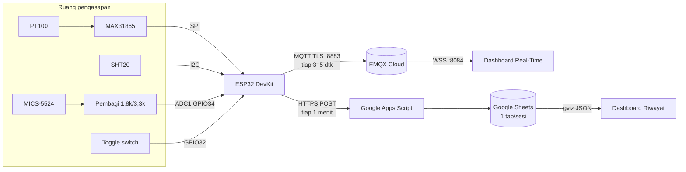

```markdown
# Smoking Room Monitoring

Sistem monitoring lingkungan **ruang pengasapan ikan aktif** berbasis IoT. Memantau **suhu**, **kelembapan relatif (RH)**, dan **gas CO** secara real-time, dengan pencatatan otomatis per sesi pengasapan ke Google Sheets.

Sesi dikendalikan dengan **satu toggle switch**: ON = mulai, OFF = selesai. Setiap sesi otomatis membuat **tepat satu tab baru** di Google Sheets.

---

## 📊 Objek & Metrik yang Dipantau

| Metrik | Sensor | Satuan | Keterangan |
|---|---|---|---|
| **Suhu ruang pengasapan** | PT100 3-wire + MAX31865 | °C | Rentang valid −50…400 °C |
| **Kelembapan relatif (RH)** | SHT20 (I2C) | %RH | Pemeriksaan CRC |
| **Gas CO** | MICS-5524 (analog) | mV / ppm | ppm hanya tampil setelah kalibrasi |
| **Kesehatan sensor** | — | bitmask `flt` | Fault suhu/RH/CO + status pemanasan |
| **Kekuatan Wi-Fi** | ESP32 | dBm (RSSI) | Dipantau di dashboard |
| **Status sesi & antrian** | Firmware | state / jumlah | IDLE, SESSION_ACTIVE, OFFLINE, dsb. |

Sensor yang tidak terbaca ditampilkan **"—"** (tidak pernah nol palsu). Tidak ada alarm, ambang peringatan, atau notifikasi — CO ditampilkan sebagai nilai apa adanya.

---

## 🏗️ Arsitektur Sistem & Alur Data



**Alur data:**

1. **Sumber data** — tiga sensor fisik (PT100, SHT20, MICS-5524) dibaca tiap 1 detik oleh ESP32. Pembacaan CO difilter: 32 sampel ADC → buang 4 terendah & 4 tertinggi → rata-rata → filter EMA (α = 0,2).
2. **Realtime path** — ESP32 publish telemetry ke **MQTT (EMQX Cloud, TLS port 8883)** tiap `pub_ms` (default 4 dtk), dashboard berlangganan via **WebSocket Secure (port 8084)**.
3. **Recording path** — ESP32 kirim baris data ke **Google Apps Script** via HTTPS POST tiap 1 menit; Apps Script menulis ke **satu tab Google Sheets per sesi**.
4. **History path** — Dashboard Riwayat membaca daftar sesi dari endpoint `?action=sessions` (Apps Script) dan isi tab via **gviz JSON** Google Sheets.
5. **Ketahanan** — Antrian RAM 120 slot (≈ 2 jam) menampung data saat Wi-Fi putus, dikirim ulang dengan tanda `offline`. Watchdog 30 dtk, anti-duplikat sisi server, data terkirim berurutan dengan backoff.

---

## ✨ Fitur Utama Dashboard

### Dashboard Real-Time
- **Tiga kartu metrik** (Suhu, RH, CO) dengan **grafik terpisah** (Chart.js), update tiap **3–5 detik** via MQTT WebSocket.
- Menampilkan **status sesi**, **durasi**, **kekuatan Wi-Fi**, **antrian data**, dan **koneksi broker**.
- Sensor yang tidak terbaca ditampilkan **"—"** (grafik berhenti/celah, sel Sheets kosong).

### Dashboard Riwayat
- Pilih sesi dari daftar (dropdown) → tampil **grafik histori** dan **statistik** (min/rata-rata/maks).
- **Tabel lengkap** semua baris + tautan **buka/unduh CSV**.

### Kontrol Sesi
- **Satu toggle switch** — OFF→ON memulai sesi (bikin tab Sheets + mulai MQTT), ON→OFF mengakhiri sesi.
- Debounce 50 ms; setelah listrik padam, switch yang masih ON **tidak** auto-start (harus OFF lalu ON — mencegah sesi tak sengaja).

### Tahan Gangguan
- Reconnect Wi-Fi/MQTT tanpa memblokir; interval MQTT & webhook berjalan di task terpisah (dual-core).
- Anti-duplikat di Apps Script (`sid`, `seq`, `dev`, `ts` divalidasi).
- Watchdog 30 detik dengan laporan penyebab reset.

---

## ⚙️ Konfigurasi Environment

### 1. Firmware — `firmware/smokehouse/secrets.h`
Salin dari `secrets.example.h`. **File ini tidak ikut Git** (lihat `.gitignore`).

```cpp
#define WIFI_SSID       "nama-wifi"
#define WIFI_PASSWORD   "password-wifi"
#define MQTT_HOST       "xxxx.ala.emqx.cloud"    // nama domain, bukan IP
#define MQTT_PORT       8883
#define MQTT_USE_TLS    1
#define MQTT_USER       "smk_device"
#define MQTT_PASS       "<password smk_device>"
#define WEBHOOK_URL     "https://script.google.com/macros/s/<ID>/exec"
#define WEBHOOK_TOKEN   "<token, sama dengan Script Property TOKEN>"
#define DEVICE_ID       "smk-01"
```

Konfigurasi lain (interval, kalibrasi CO, Wi-Fi, dll.) bisa diubah runtime lewat Serial Monitor — tersimpan di NVS tanpa kompilasi ulang:

```
set pub_ms 3000
reboot
```

### 2. Dashboard — `web/config.js` (**PUBLIK**, ikut terbit ke GitHub Pages)

```js
window.APP_CONFIG = {
  DEVICE_ID: "smk-01",
  MQTT: {
    URL: "wss://<alamat-broker>:8084/mqtt",
    USERNAME: "smk_dashboard",              // akun BACA saja
    PASSWORD: "<password dashboard>"
  },
  SHEETS: {
    SPREADSHEET_ID: "<ID Spreadsheet>",
    WEB_APP_URL: "https://script.google.com/macros/s/<ID>/exec"
  },
  STALE_AFTER_S: 15,      // tanpa data selama ini → "tidak ada data baru"
  CHART_MAX_POINTS: 300   // titik grafik real-time (300 × 4 dtk = 20 menit)
};
```

> ⚠️ **Hanya akun `smk_dashboard` (read-only)** yang boleh ada di sini. Jangan pernah menaruh token webhook atau akun `smk_device`.

### 3. Apps Script — Script Properties
Buka **Extensions → Apps Script → Project Settings → Script Properties**, isi:

| Properti | Contoh | Wajib |
|---|---|---|
| `TOKEN` | 32 karakter acak | ✅ (harus sama dengan `WEBHOOK_TOKEN` di firmware) |
| `SPREADSHEET_ID` | `1AbC…` | Opsional bila skrip dibuat dari dalam Spreadsheet |

### 4. EMQX Cloud
Buat dua pengguna di **Access Control → Authentication**:
- `smk_device` — publish ke `smokehouse/smk-01/#` (rahasia)
- `smk_dashboard` — subscribe ke `smokehouse/#` (publik)

Set **All Users: Deny** untuk `#` (mode whitelist).

---

## 🚀 Menjalankan Cepat

1. **EMQX** — buat deployment, catat alamat broker, buat dua akun, atur Authorization whitelist.
2. **Sheets + Apps Script** — tempel `gsheet/Code.gs`, isi Script Property `TOKEN`, jalankan `setup()` → `selfTest()`, deploy sebagai Web App (*Execute as Me*, *Anyone*), share Spreadsheet sebagai *Anyone with the link: Viewer*.
3. **Firmware** — isi `secrets.h`, unggah ke ESP32 (Arduino IDE, board **ESP32 Dev Module**, library *Adafruit MAX31865* + *PubSubClient*).
4. **Dashboard** — isi `web/config.js`, push ke `main`. Workflow GitHub Actions menerbitkan `web/` ke GitHub Pages (*Settings → Pages → Source: GitHub Actions*).
5. **Uji** — buka dashboard, geser switch ON → tab baru muncul di Sheets, grafik bergerak, baris data pertama muncul setelah 1 menit.

---

## 📁 Struktur Singkat

```
├── firmware/smokehouse/     # smokehouse.ino, secrets.example.h (secrets.h di-ignore)
├── gsheet/                  # Code.gs (webhook + sessions API), appsscript.json
├── web/                     # index.html, riwayat.html, script.js, config.js, style.css
└── .github/workflows/       # deploy web/ ke GitHub Pages
```

---

## ⚠️ Status & Batasan

- **Kode lengkap**, sudah diuji **simulasi** (ESP32 + broker + Sheets asli, tanpa sensor).
- **Validasi hardware & uji lapangan belum dilakukan.**
- **CO hanya dalam mV** sampai kalibrasi nyata diisi (`co_mode 1` atau `2`) — ppm tanpa kalibrasi berbahaya karena terlihat meyakinkan padahal salah.
- **Verifikasi sertifikat TLS belum aktif** (`setInsecure`); mitigasi: jaringan Wi-Fi tepercaya atau isi `MQTT_CA_CERT`.
- Sesi yang tidak ditutup (listrik padam) tetap berstatus `ACTIVE` di Riwayat.
- Antrian RAM hanya ±2 jam; bila Wi-Fi putus lebih lama, baris DATA tertua dibuang (START/STOP dipertahankan).

---

## 🔒 Keamanan

- `secrets.h` **tidak boleh masuk Git** — pastikan `.gitignore` ada dan periksa `git status` sebelum commit.
- `web/config.js` hanya memuat akun **baca** (`smk_dashboard`); tidak ada token atau akun publish.
- Rahasia yang terlanjur ter-push dianggap **bocor**: ganti kredensialnya, baru bersihkan riwayat Git.

**Checklist sebelum dipakai lapangan:**
- [ ] `secrets.h` hanya ada di komputer; `git status` tidak menampilkannya
- [ ] `config.js` hanya berisi akun `smk_dashboard`
- [ ] EMQX: aturan Allow per pengguna + Deny-all di "All Users"
- [ ] Script Property `TOKEN` terisi dan sama dengan firmware
- [ ] Web App: Execute as **Me**, access **Anyone**; Spreadsheet: **Viewer**
- [ ] `co_mode` sesuai (0 sampai kalibrasi nyata tersedia)

---

## 📜 Lisensi

Belum ditetapkan — tambahkan berkas `LICENSE` sebelum dipakai pihak lain.

**Library:** PubSubClient, Adafruit MAX31865, MQTT.js, Chart.js, Font Awesome.
```
